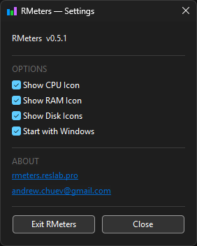

# rmeters

A lightweight system monitor for the Windows notification area (system tray), written in Rust. Small scrolling graphs next to the clock show CPU, RAM and disk load in real time, in the spirit of the classic xMeters utility.

**[Download Latest Release](https://github.com/andrewchuev/rmeters/releases/latest)**


## Screenshots

Tray icons (enlarged ×6) — CPU, RAM and two disk volumes:


Low-space alerts — a volume over 80% full turns yellow, over 90% red:


Settings window, opened by clicking any tray icon:



## Features

- **CPU and RAM Icons**: Scrolling sparkline graphs with a 60-second history — CPU in blue, RAM in green. Hover an icon for the exact value.
- **Disk Icons**: One icon per local fixed volume (C:, D:, …) graphing its active time, the same metric Task Manager shows. The tooltip shows the drive letter, active time and free space. Volumes that appear or disappear are picked up automatically; removable and network drives are not shown.
- **Disk Space Alerts**: Below 80% used, the disk graph is a violet line on a transparent background. From 80% (low space) the whole icon is filled yellow, and from 90% (critically low) red, with the graph drawn in dark on top, so a nearly full drive stands out even when idle.
- **Per-Icon Toggles**: CPU, RAM and disk icons can be shown or hidden individually; at least one always stays visible so the settings remain reachable.
- **Settings Window**: Left- or right-click any tray icon to toggle icons and autostart, or to exit the app.
- **Explorer Restart Recovery**: Icons are re-added automatically when Explorer restarts.
- **High-DPI Support**: Icons and the Settings window adapt to the monitor's scaling (100%, 150%, 200%, etc.).
- **Light on Resources**: Near-zero CPU usage and a small memory footprint.
- **No Dependencies**: Statically linked against the C runtime — runs on a clean Windows install without the Visual C++ Redistributable.
- **Installer or Portable**: Ships as an Inno Setup installer (`rmeters-setup.exe`) with Start Menu shortcut and optional autostart, and as a portable zip.

## Installation

### Installer (recommended)

Download `rmeters-setup.exe` from the [latest release](https://github.com/andrewchuev/rmeters/releases/latest) and run it. The installer will:

- Place `rmeters.exe` in `%ProgramFiles%\RMeters`
- Create a Start Menu shortcut
- Optionally register rmeters to start with Windows
- Register an uninstaller in "Add or remove programs"

### Portable

Download `rmeters-windows-x64-portable.zip`, extract anywhere, and run `rmeters.exe` directly.

## Usage

Click any rmeters tray icon to open the Settings window:

| Setting | Description |
|---|---|
| Show CPU Icon | Show or hide the CPU load graph icon |
| Show RAM Icon | Show or hide the RAM usage graph icon |
| Show Disk Icons | Show or hide the per-volume disk activity icons |
| Start with Windows | Enable / disable autostart via the registry |
| Exit RMeters | Quit the application |

Windows may place new icons in the hidden overflow area; drag them onto the taskbar (or enable them in *Settings → Personalization → Taskbar → Other system tray icons*) to keep them always visible.

Settings are stored in `%APPDATA%\rmeters\config.txt`.

## System Requirements

- Windows 10 or Windows 11 (64-bit)
- No additional runtime libraries required

## Build from Source

```bash
# Development
cargo run

# Optimized release binary
cargo build --release

# Checks
cargo clippy --all-targets
cargo test
```

The compiled binary will be at `target/release/rmeters.exe`.

## How it Works

- **Metrics Collection**: A background thread polls CPU and memory stats every second using the `sysinfo` crate, initialized lazily with `System::new()` to avoid full-system scans.
- **Disk Activity**: Fixed volumes are found with `GetLogicalDrives` + `GetDriveTypeW`. Active time is `100 − \LogicalDisk(X:)\% Idle Time` read through the Performance Data Helper (PDH) API; free space comes from `GetDiskFreeSpaceExW`.
- **Icons**: Each tick, every enabled icon is drawn as a GDI sparkline into a fresh `HICON` (color bitmap plus transparency mask) and pushed to the shell with `Shell_NotifyIconW`; the previous handle is destroyed.
- **Hidden Main Window**: A never-shown top-level window owns the icons and receives their click callbacks. It is not a message-only window, so it also receives the `TaskbarCreated` broadcast used to re-add icons after an Explorer restart.
- **Autostart**: Toggled through the `HKCU\Software\Microsoft\Windows\CurrentVersion\Run` registry value, with errors taken from the registry API return codes.
